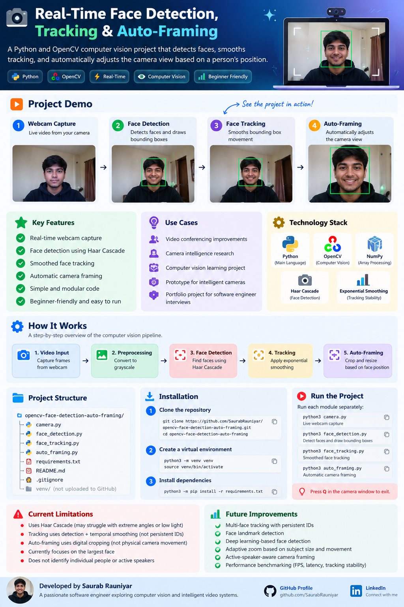

<div align="center">

# Real-Time Face Detection, Tracking & Auto-Framing

**A practical computer vision project built with Python and OpenCV**


*A webcam-based prototype that detects faces, reduces bounding-box jitter and adjusts a digital camera crop to follow a person.*

[Features](#features) · [How it works](#how-it-works) · [Getting started](#getting-started) · [Limitations](#limitations) · [Next steps](#next-steps)



</div>

---

## Features

| Module | What it demonstrates | Run |
| :--- | :--- | :--- |
| 📷 **Webcam capture** | Opens the webcam and displays live frames | `python3 camera.py` |
|**Face detection** | Detects frontal faces and draws green bounding boxes | `python3 face_detection.py` |
|**Smoothed face tracking** | Reduces bounding-box jitter through exponential smoothing | `python3 face_tracking.py` |
|**Automatic framing** | Moves a digital crop toward the detected face with smoothing and a dead zone | `python3 auto_framing.py` |

> **Note:** Each script runs independently. This is a learning prototype, not a production camera system.

## How it works

```text
Webcam → Frame capture → Grayscale conversion → Haar Cascade detection
                                                ↓
                                     Face bounding box
                                                ↓
                                      Temporal smoothing
                                                ↓
                               Digital crop and resize (auto-framing)
```

**Face detection:** OpenCV's pretrained Haar Cascade returns a bounding box `(x, y, width, height)` for each detected frontal face.

**Smoothing:** The tracked box is blended with its previous position to reduce visual jitter:

```text
smoothed = α × current_detection + (1 − α) × previous_smoothed
```

A smaller `α` gives steadier motion but can react more slowly.

**Auto-framing:** The program estimates the face center, gradually shifts a crop toward it, and resizes the crop for display. A **dead zone** avoids unnecessary movement when the detected face shifts only a little. This is digital cropping, not physical camera movement.

## Getting started

**Requirements:** A working webcam, camera permissions, Python 3.9 or a compatible version, and OpenCV.

**1. Clone the repository**

```bash
git clone https://github.com/SaurabRauniyar/opencv-face-detection-auto-framing.git
cd opencv-face-detection-auto-framing
```

**2. Create and activate a virtual environment**

```bash
python3 -m venv venv
source venv/bin/activate
```

**3. Install dependencies**

```bash
python3 -m pip install -r requirements.txt
```

**4. Run any module**

```bash
python3 camera.py
python3 face_detection.py
python3 face_tracking.py
python3 auto_framing.py
```

Run them one at a time. Focus the OpenCV window and press **Q** to exit.

## Project files

```text
opencv-face-detection-auto-framing/
├── camera.py
├── face_detection.py
├── face_tracking.py
├── auto_framing.py
├── assets/
│   └── project-poster.png
├── requirements.txt
├── .gitignore
└── README.md
```

## Technology and techniques

| Technology / concept | Purpose |
| :--- | :--- |
| **Python** | Application logic |
| **OpenCV** | Capture, preprocessing, detection, drawing and display |
| **Haar Cascade classifier** | Pretrained frontal-face detection |
| **Exponential smoothing** | Reduce frame-to-frame bounding-box and crop movement |
| **Region of interest (ROI)** | Crop the portion of the frame used for auto-framing |

## Limitations

- Haar Cascade can miss faces in poor lighting, with occlusion, or at large head angles.
- The `face_tracking.py` script smooths repeated detections; it does **not** maintain persistent identities or implement a dedicated object tracker.
- Auto-framing follows the largest detected face and is limited to pixels captured by the webcam.
- No face recognition, speaker detection, or audio-based active-speaker selection is implemented yet.
- Frame rate, latency and detection accuracy have not been benchmarked.

## Next steps

- [ ] Record a short **real demo GIF** showing detection and auto-framing
- [ ] Explore multi-person tracking with persistent IDs
- [ ] Evaluate more robust face detectors
- [ ] Add adaptive zoom and smoother camera composition
- [ ] Measure FPS, latency and tracking stability

## Why I built this

I built this project to learn real-time computer vision through small, testable steps—from webcam access to detection, smoothing and automated digital framing. It also serves as a starting point for exploring intelligent video collaboration systems.

---


<div align="center">

# Real-Time Face Detection, Tracking & Auto-Framing

**A practical computer vision project built with Python and OpenCV**


A webcam-based prototype that detects faces, reduces bounding-box jitter and adjusts digital camera framing.

[Features](#features) · [How it works](#how-it-works) · [Getting started](#getting-started)

</div>

---


## Features

| Module | Description |
| :--- | :--- |
| 📷 Webcam | Captures live video |
| Face Detection | Draws bounding boxes |
| Face Tracking | Smooths bounding box movement |
| Auto-Framing | Adjusts the digital camera view |
